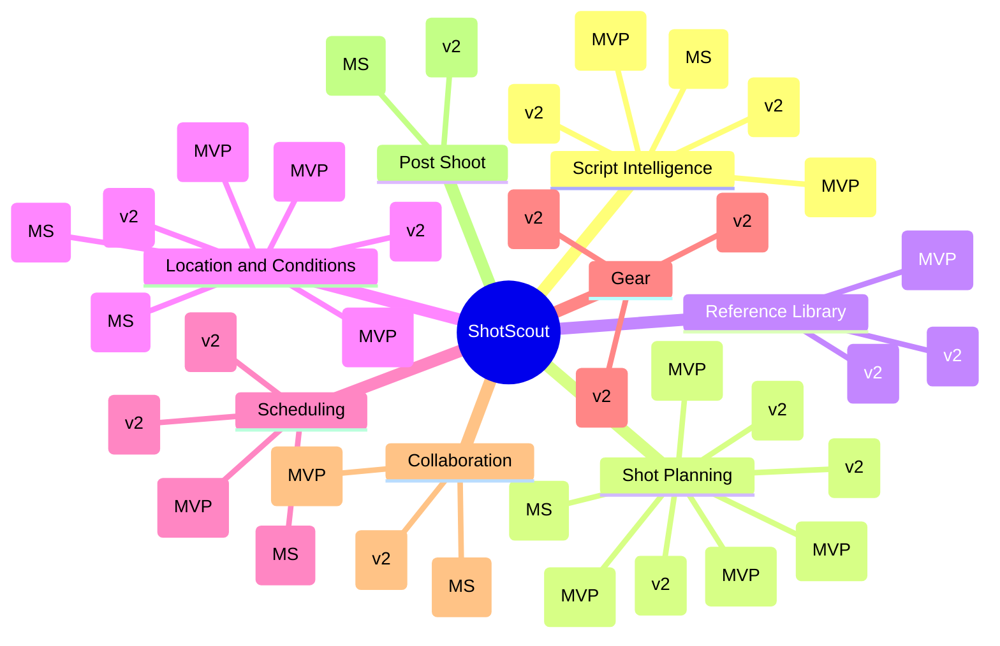
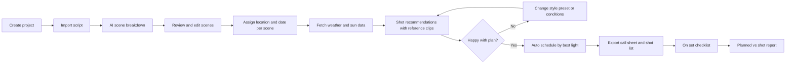
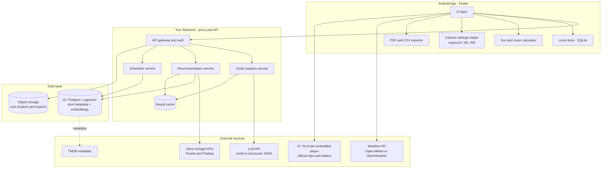
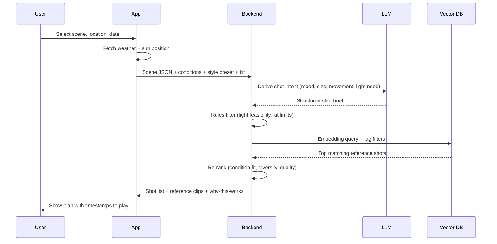
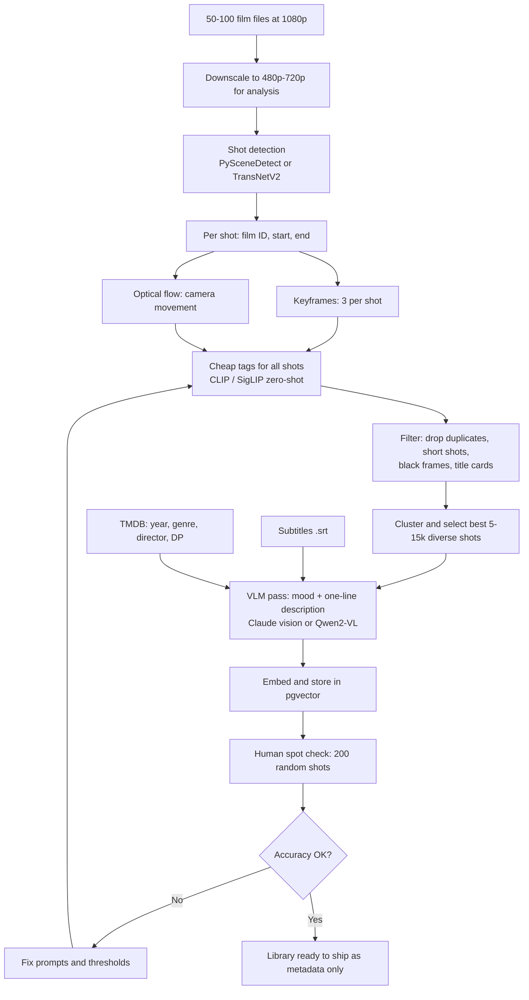
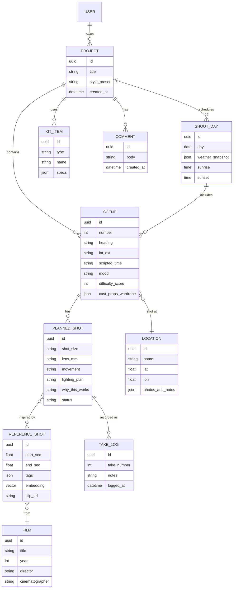
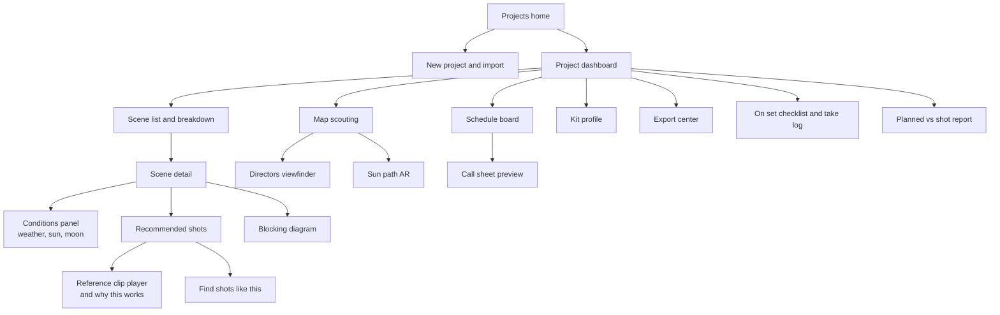

# Cinematic Shot Planner: Product & Technical Plan

*Working title: **ShotScout** (rename freely). Android-first app that turns a script plus location and weather into a shot plan and schedule. Each shot comes with a free stock-footage preview of the same kind of shot; film clips come in v2.*

---

## 1. Vision

Paste a script. The app breaks it into scenes, checks the weather, sun, and time at your shooting location, and recommends the best shots for each scene by name, with a short reason and a best-light window for each, plus a free stock-footage preview of the same kind of shot. Later versions add real film references showing the look. It then builds your shooting schedule.

**Scope:** pre-production planning only. No in-app camera. Users record with any camera app (for example Blackmagic Camera) or a real camera; ShotScout suggests the settings to dial in for each shot (frame rate, shutter, ISO, white balance, ND, aperture, profile).

**Decisions made (v1):**
- **Android first.** The primary device is Android, Android Studio runs on Windows, and Play Store registration is a one-time fee. iOS follows later (Flutter makes that cheap).
- **Shot names plus free stock-footage references in v1.** No film library yet, because there is no data. Each suggestion is a name, shot size, lens, movement, a one-line reason, a best-light window, and a preview clip of the same kind of shot from the Pexels and Pixabay APIs, with the source credited. Film examples come later.
- **The reference library moves to v2.** The offline pipeline (section 6) is still the plan, and your RTX 3050 8GB PC is enough for it. Clips will play through official YouTube embeds, not cut footage.

**Differentiator:** nobody ties *script + real-world light + a searchable library of real film shots* together in one tool.

**Open decisions (to confirm before build):**
| Question | Why it matters |
|---|---|
| Target user: film students, indie filmmakers, or creators? | Drives UI complexity and pricing |
| Personal project or paid product? | Drives legal work (see section 9) |
| GPU: resolved, you have an RTX 3050 8GB, which is enough | Library pipeline (needed for v2, not v1) |
| Do the 50-100 films have subtitle files? | Dialogue/emotion tagging quality |
| Which films will you pick, and where do the copies come from? (v2) | Coverage of looks, and the legal footing (see section 9) |
| Flutter or native Kotlin? | **Decided: Flutter.** No in-app camera, so native camera access is not needed, and iOS stays cheap |

---

## 2. Feature Map

Legend: **MVP** = first release, **v2** = second wave, **MS** = moonshot.



---

## 3. User Journey



---

## 4. System Architecture



**Key rules**
- The LLM key lives only on your backend, never in the app.
- Weather can be fetched straight from the app, or through your backend if you want caching. Sun and moon data are computed on-device.
- The app never contains film footage, only metadata, tags, embeddings, and links.
- **v1 uses only:** script analysis, the scheduler, a rules-plus-LLM shot suggester, and a stock-footage lookup. The stock-footage API keys stay on your backend, and the backend caches results per search query. The vector database and YouTube player arrive in v2.

---

## 5. Recommendation Engine

How a scene becomes a ranked list of shots.

**v1 (no library yet):** the backend asks the LLM for shot suggestions from the scene text and the conditions, restricted to a fixed vocabulary of shot sizes, lens lengths, and camera movements. The rules below then filter the shots and order them by best-light window. Each suggestion carries a name, shot size, lens, movement, a one-line reason, and a best-time window. Each suggestion also carries a short search query (for example "sunset silhouette beach"), which the backend uses to fetch a matching stock clip from Pexels or Pixabay. There is no vector search and no film clip in v1. The diagram below is the v2 target, once the reference library exists.



**Scoring idea (tunable):**

```
score = 0.35 * semantic_match      (scene mood vs shot embedding)
      + 0.25 * light_fit           (expected light vs shot lighting tag)
      + 0.15 * style_match         (preset: noir, handheld doc, pastel...)
      + 0.15 * feasibility         (kit, difficulty, location type)
      + 0.10 * diversity_bonus     (avoid 5 near-identical shots)
```

**Example rules**
- Harsh noon sun + close-up on faces: warn, suggest shade, diffusion, or a different time.
- Overcast + tense scene: favor tight close-ups and soft, low-contrast references.
- Night exterior with no lighting kit: suggest dusk shooting or practical lights.
- Forecast beyond about 10 days: show seasonal averages labeled as estimates.

---

## 6. Reference Library Pipeline (v2, Offline, One-Time)

**Not part of v1.** Start this after the v1 beta, once there is film data to work with.

Input: your 50-100 film files (1080p). Runs on your RTX 3050 8GB PC, never inside the app.



### Tag schema

| Field | Values / type | Source |
|---|---|---|
| shot_size | ECU, CU, MCU, MS, MWS, WS, EWS | Face ratio + CLIP |
| camera_movement | static, pan, tilt, push-in, pull-out, tracking, handheld, crane | Optical flow |
| lighting | backlit, low-key, high-key, golden hour, overcast, practical, silhouette | CLIP + histogram |
| setting | INT / EXT, day / night / dusk / dawn | CLIP |
| depth_of_field | shallow, medium, deep | Blur estimate |
| palette | 5 dominant colors | K-means |
| mood | tense, intimate, melancholic, epic, etc. | VLM |
| description | one-liner | VLM |
| film_meta | title, year, genre, director, cinematographer | TMDB |
| clip_link | YouTube URL + start/end seconds, if an official clip exists | Manual or search |
| embedding | vector(512 or 768) | CLIP / SigLIP |

**Scale note:** 50-100 films is roughly 100-200 hours, or about 75k-250k shots. Run cheap tags on everything, then run the expensive VLM only on the curated subset (5-15k shots). At this size the whole pipeline should take hours to a couple of days, and the VLM pass should cost tens of dollars, not hundreds. These are rough estimates; benchmark on 2-3 films before committing.

**Resolution:** 1080p is more than enough. Downscale to 480p-720p before analysis, since shot detection, CLIP, and optical flow don't benefit from full resolution and it speeds everything up.

**Choosing your 50-100 films matters more than the count.** With a small library, coverage is the quality driver:
- Pick for **variety of lighting**: golden hour, overcast, harsh noon, night exterior, candlelit interior, neon.
- Pick for **variety of style**: noir, handheld documentary, symmetrical, epic landscape, intimate drama.
- Include **acclaimed cinematographers** (Deakins, Lubezki, Storaro, Khondji, Cronenweth, and others) and a mix of eras and countries.
- Aim for roughly 5-8 films per major "look" so every style preset has enough references.

---

## 7. Data Model



---

## 8. Screen Map



---

## 9. Legal & Compliance

This is the biggest non-technical risk for v2. **v1 sidesteps most of it, because it contains no film content at all:** only shot names and descriptions written by the app.

| Topic | Plan |
|---|---|
| Film files | Private use to generate tags and embeddings is different from distribution. Use copies you legitimately own (for example, discs or purchases), not pirated downloads. If you plan to launch commercially, your source and rights matter even more. |
| In the app | **Ship metadata only:** title, timestamp, tags, embeddings. **No footage, no frame thumbnails.** |
| Stock footage (v1) | Both Pexels and Pixabay want the source credited wherever clips appear; Pexels also wants a prominent link to Pexels and credit to the videographer. Do not rebuild a stock-footage browser: Pexels forbids copying its core functionality. Pixabay says to cache results for 24 hours and not to mass-download. Read each site's current API terms before launch. |
| Playing references | YouTube embedded player with official clips or trailers and start/end timestamps, or link users to a legitimate streaming source. |
| Posters and metadata | TMDB with required attribution. |
| AI storyboards | Generate original art only. Never depict real films or characters. |
| User scripts | Privacy policy and encryption in transit and at rest. State clearly whether scripts are used for training (recommended: never). |
| LLM usage | Send scripts via your backend. Check your LLM provider's data-retention terms. |
| Before launch | If this is commercial, have an IP lawyer review the library and clip-linking approach. |

---

## 10. Tech Stack

| Layer | Choice | Notes |
|---|---|---|
| Android app | Flutter | Android 8+; iOS later from the same code |
| Local storage | SQLite (sqflite or drift) | Offline-first projects |
| Camera | None in-app | Suggest settings; "Open in camera app" launches Blackmagic Camera or similar |
| Weather | Open-Meteo (free for non-commercial use) or OpenWeather | Forecasts only reach about 1-2 weeks; show seasonal averages beyond that, labeled as estimates. Check licensing before you charge for the app. |
| Sun/moon | On-device calculation | Sunrise, sunset, azimuth, golden/blue hour, moon phase |
| AR / viewfinder (moonshot) | Flutter camera + ARCore plugins | Optional; only if users ask for it |
| Maps (v2) | Google Maps SDK or MapLibre | Scouting pins |
| Reference footage (v1) | Pexels and Pixabay video APIs, called through your backend | Free. Pexels default is 200 requests per hour and 20,000 per month; Pixabay default is 100 per minute. Cache results per shot query. |
| Video player (v1) | video_player (ExoPlayer on Android) | Plays stock clips in the app |
| Video playback (v2) | android-youtube-player library or a WebView | Official clips with start and end times |
| Backend | Python FastAPI (or Supabase Edge Functions) | Proxy, scheduler, recommender |
| Database | Postgres + pgvector | Shot metadata and embeddings |
| Auth | Google Sign-In | Add Sign in with Apple if you ship on iOS |
| LLM | Structured JSON output, scene-by-scene, cached | Cost control |
| Offline pipeline (v2) | Python, PySceneDetect/TransNetV2, OpenCV, CLIP/SigLIP, VLM | Your RTX 3050 8GB PC |
| Payments (if paid) | Google Play Billing | |
| Analytics / crashes | TelemetryDeck or PostHog, plus Sentry | Privacy-friendly |

---

## 11. Roadmap

```mermaid
gantt
    title ShotScout Roadmap (Android first, start dates assume early November 2026)
    dateFormat  YYYY-MM-DD
    axisFormat  %b %d
    section Foundation
    Decisions, shot vocabulary, LLM prompts :a1, 2026-11-02, 7d
    Backend skeleton and auth              :a2, after a1, 10d
    section v1 MVP (shot names only)
    Script import and scene breakdown      :c1, 2026-11-16, 14d
    Weather, sun, conditions panel         :c2, after c1, 10d
    Shot name suggestions (rules + LLM)    :c3, after c2, 14d
    Camera settings per shot               :c3a, after c3, 5d
    Stock footage previews and credits     :c3b, after c3a, 7d
    Auto schedule and PDF/CSV export       :c4, after c3b, 10d
    v1 beta (Play internal testing)        :milestone, m1, after c4, 0d
    section Library Pipeline (v2)
    Pick films and prepare 720p copies     :b0, after m1, 4d
    Shot detection and keyframes           :b1, after b0, 4d
    Cheap tagging and flow on all shots    :b2, after b1, 5d
    Curate subset and VLM tagging          :b3, after b2, 7d
    Embeddings, QA, spot check             :b4, after b3, 5d
    section v2
    Style presets and DOF calculator       :d1, after m1, 14d
    Find shots like this                   :d2, after m1, 10d
    Kit profile (gear-aware settings)      :d3, after d1, 10d
    Map scouting and weather replanning    :d4, after d2, 14d
    Call sheet, calendar sync, sharing     :d5, after d3, 14d
    On set checklist and take log          :d6, after d4, 10d
    v2 release                             :milestone, m2, after d6, 0d
    section Moonshots
    Resolve markers, storyboards, reports  :e1, after m2, 30d
```

Timeline assumes one developer working part-time on the app while the pipeline runs unattended. Adjust once team size is known.

---

## 12. Phase Breakdown

### Phase 0: Foundation (about 1-2 weeks)
- [ ] Confirm target user and business model
- [ ] Legal review of how the library will be used
- [ ] Finalize tag schema and scoring weights
- [ ] Define the fixed vocabulary for shot suggestions (shot sizes, lenses, movements, lighting plans)
- [ ] Write and test the LLM prompts for scene breakdown and shot suggestions
- [ ] (v2) Choose the 50-100 films for coverage of lighting and style
- [ ] (v2) Benchmark pipeline on 2-3 films (time and cost per film)

### Phase 1: MVP
- [ ] Import: paste, Fountain, FDX, PDF
- [ ] Scene breakdown with cast, props, locations, and day/night split
- [ ] Per-scene location and date, with Open-Meteo weather and on-device sun data
- [ ] Camera settings per shot: frame rate, shutter, ISO, white balance, ND, aperture, profile, based on expected light
- [ ] "Open in camera app" button (Blackmagic Camera or the user's choice); settings shown as an on-set checklist
- [ ] Golden/blue hour countdown and seasonal fallback
- [ ] Coverage suggestions (master, OTS, singles, inserts, cutaways)
- [ ] Shot names with a short "why this works" and a best-light window
- [ ] A reference preview per shot: drawn shot diagram plus a free stock clip from Pexels or Pixabay, with the source credited and a link back to it
- [ ] Backend proxy for the stock APIs: keys kept server-side, results cached per shot query, and a fallback to the drawn diagram when no clip is found
- [ ] Auto-schedule ordered by light and location grouping
- [ ] PDF and CSV export

**Success criteria:** a user can go from a pasted 10-page script to a scheduled shot list in under 15 minutes, and rates at least 7 of 10 suggested shots as sensible for the scene and the light.

### Phase 2: Differentiators
- [ ] Build the reference library (section 6) and attach YouTube clip links with a confidence level (precise, scene-level, trailer-only, none)
- [ ] Reference clips and "find shots like this" in the shot cards
- [ ] Find shots like this (image to library search)
- [ ] Style presets, kit profile (camera settings limited to the user's gear), DOF calculator
- [ ] Map scouting, weather-adaptive replanning, rain plans
- [ ] Emotion graph, difficulty score, blocking diagrams, continuity warnings
- [ ] Call sheet, calendar sync, sharing and comments
- [ ] On-set checklist and take log

### Phase 3: Moonshots
- [ ] Director's viewfinder and sun-path AR (only if users ask for them)
- [ ] Export markers to DaVinci Resolve and Premiere
- [ ] Original AI storyboard frames
- [ ] Budget estimates
- [ ] Voice table read
- [ ] Planned vs shot report

---

## 13. Risks & Mitigations

| Risk | Impact | Mitigation |
|---|---|---|
| Copyright on film material (v2) | Takedown, store rejection | Metadata-only shipping, official clip links, legal review. v1 contains no film content. |
| No library data in v1 | Suggestions feel generic | Make every suggestion specific (shot size, lens, movement, reason, light window) and add thumbs up/down to learn what to build first |
| Stock footage search misses | A shot shows an irrelevant or no clip | Write good search queries per shot type, let users thumbs-down a clip, and fall back to the drawn diagram |
| Stock API limits and terms change | Previews stop working or break the rules | Cache per query, keep keys on the backend, request higher limits if needed, and re-read the terms before launch |
| Weak recommendation quality | Users churn | Invest in library QA, human spot checks, feedback buttons on every suggestion |
| LLM cost on long scripts | Margin pressure | Scene-by-scene analysis, caching, cheaper model for first pass |
| Forecast limited to about 10 days | Planning gaps | Seasonal averages, clearly labeled |
| Auto-tags inaccurate | Wrong references | Measure accuracy per tag, drop tags below threshold |
| Clip links break | Missing references | Link health checker and fallback to "where to watch" |
| Scope creep | Never ships | Hold the MVP list above; everything else waits |
| Script privacy concerns | Trust loss | Encryption, no training on user scripts, clear policy, delete-account support |

---

## 14. Metrics

- **Activation:** % of new users who finish a scene breakdown
- **Core value:** shots saved or added per scene; relevance thumbs-up rate
- **Retention:** projects returning to the schedule view after day 7
- **Quality:** recommendation relevance rating, tag accuracy from spot checks
- **Cost:** LLM spend per script, pipeline cost per film

---

## 15. Immediate Next Steps

1. Answer the open decisions in section 1.
2. Draft the LLM prompt and JSON schema for scene breakdown and for shot suggestions (name, shot size, lens, movement, reason, best-light window).
3. Scaffold the Flutter project with script import and the weather/sun layer.
4. Review the seven app screens in the "ShotScout Android App" design and adjust them.
5. Get free API keys for Pexels and Pixabay and test a few shot queries (for example "sunset silhouette") to see how good the results are.
6. Later, for v2: pick films, benchmark the pipeline on 2-3 of them, then build the library.
